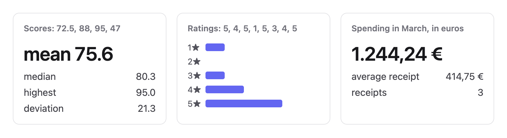
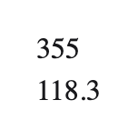

# dcss.css

dcss.css does a page's arithmetic in CSS. It sums, averages and ranks a list, maps a number through a scale, prints numbers and dates the way d3 prints them, looks values up in a table, and solves formulas you write. The numbers are written in HTML, the browser lays them out, and each answer is read back from that layout, so no script runs. Change a number and every answer that depends on it changes in the same frame.

It is not a chart library: it computes the numbers, and the page draws them with ordinary CSS. It works in Chrome and Safari, and in part in Firefox ([Browsers](#browsers)).



## Installation

Each call is a class, with its own file in `parts/`. Put the class on a `<figure>` around a list. The browser lays the list out, and the list's size is the answer. This page links two parts that come to 20 KB gzipped:

```html
<!doctype html>
<link rel="stylesheet" href="parts/dcss-mean.css">
<link rel="stylesheet" href="parts/dcss-format-fixed.css">

<figure class="dcss-mean dcss-format-fixed">
  <ul><li style="--value: 120"></li> <li style="--value: 95"></li> <li style="--value: 140"></li></ul>
  <output style="--value: var(--dcss-sum); --precision: 0"></output>   <!-- 355 -->
  <output style="--value: var(--dcss-mean); --precision: 1"></output>  <!-- 118.3 -->
</figure>
```



Each item gives its number as `--value`. The outputs after the list read `--dcss-sum`, `--dcss-mean` and `--dcss-count`, and change when a `--value` does.

For many calls on one page, link `dcss.css` and the family files [Reference](#reference) names, or all of them in `dcss-all.css`:

```html
<link rel="stylesheet" href="dcss.css">
<link rel="stylesheet" href="families/array.css">
<link rel="stylesheet" href="families/format.css">
```

## Writing a call

A call is named after d3's function, so d3.bisectLeft is `.dcss-bisect-left`. Its arguments are custom properties with d3's names, such as `--p`. Use one call per figure.

```html
<figure class="dcss-sum">
  <ul aria-hidden="true"><li style="--value: 12"></li> <li style="--value: 40"></li> <li style="--value: 30"></li></ul>
  <output></output>                  <!-- prints 82 -->
  <figcaption>Fruit sold: apples 12, pears 40, plums 30</figcaption>
</figure>
```

Give the output a format class to print the answer as you want it: `<output class="dcss-format-fixed" style="--precision: 2; --symbol: 1"></output>` prints $82.00. An output with a `--value` of its own prints that instead, such as `calc(var(--dcss-sum) / 100)` for cents.

The list is drawn at the answer's size, so hide it with `overflow: clip` on the figure, never on the list. Screen readers don't hear a `--value`, so say the numbers in a caption. They do hear a printed answer.

A figure is a block. For a total inside a sentence, put the sentence in a `<div>` (a `<p>` ends before a `<figure>`) and give the figure `display: inline-block` in a rule that names its class, such as `figure.total { display: inline-block }`.

Values are whole numbers, or up to 3 decimals in a sum. For prices such as 12.99 in any other call, add the class `dcss-decimals` and `--decimals: 2` to the figure; a median or a quantile needs only `--decimals`. The answers are then exact decimals, and 0.1 + 0.2 is 0.3.

A value the page changes with a rule, such as `:has(#x:checked) li.a { --value: 50 }`, goes in a class rule, since an item's `style` would win. `.dcss-summarize`, `.dcss-variance` and `.dcss-deviation` read each item's `style`, so there point it at the rule's property: `style="--value: var(--price)"`.

When a call has no answer, it prints nothing and sets `--dcss-err`. It is 2 where d3 gives no number either, as for an empty list's mean, and 1 where the call failed ([SPEC.md](SPEC.md) lists those cases). A style query shows a message instead:

```html
<style>
  .ok output::after { counter-reset: i var(--dcss-max-index); content: counter(i); }
  .bad { display: none; }
  @container style(--dcss-err: 1) { .ok { display: none; } .bad { display: inline; } }
</style>
<figure class="dcss-max-index" style="overflow: clip">
  <ul><li style="--value: 3"></li><li style="--value: 9"></li><li style="--value: 4"></li></ul>
  <div><span><span class="ok">Highest: item <output></output></span><span class="bad">no answer</span></span></div>
</figure>
```

## Using two calls together

Put one call inside another's answer. Here a sum feeds a scale:

```html
<figure class="dcss-sum">
  <ul>
    <li style="--value: 12"></li> <li style="--value: 40"></li> <li style="--value: 30"></li>
  </ul>
  <div class="dcss-scale-linear"
       style="--value: var(--dcss-sum);
              --domain-0: 0; --domain-1: 2000;
              --range-0: 0; --range-1: 1000">
    <output class="dcss-format-si"
            style="--value: var(--dcss-scale-linear); --precision: 3"></output> <!-- 41.0 -->
    <output class="dcss-format-fixed"
            style="--value: calc(var(--dcss-scale-linear) * 2); --precision: 2"></output> <!-- 82.00 -->
  </div>
</figure>
```

The scale follows the sum in the same frame. A list whose items hold another list's answer follows it a frame later, per level.

## Every answer from one list

`.dcss-summarize` gives the sum, count, length, mean, min, max, median, variance and deviation of one list. Every element after the list reads them, a caption and any number of outputs, in the order written:

```html
<figure class="dcss-summarize dcss-decimals dcss-format-fixed" style="--decimals: 1; --precision: 1">
  <figcaption>Scores</figcaption>
  <ul><li style="--value: 72.5"></li> <li style="--value: 88"></li> <li style="--value: 95"></li> <li style="--value: 47"></li></ul>
  <output style="--value: var(--dcss-mean)"></output>       <!-- 75.6 -->
  <output style="--value: var(--dcss-max)"></output>        <!-- 95.0 -->
  <output style="--value: var(--dcss-deviation)"></output>  <!-- 21.3 -->
</figure>
```

## Looking up a value

`.dcss-lookup` works like a spreadsheet's exact lookup. It gives the `--value` of the row whose `--key` equals the figure's `--find`. Keys are numbers, such as a product number or a year, and prices go in cents:

```html
<figure class="dcss-lookup dcss-format-fixed" style="--find: 102; --precision: 2; overflow: clip">
  <ul aria-hidden="true">
    <li style="--key: 101; --value: 1250"></li>
    <li style="--key: 102; --value: 899"></li>
    <li style="--key: 205; --value: 4500"></li>
  </ul>
  <div><output style="--value: calc(var(--dcss-lookup) / 100)"></output></div>  <!-- 8.99 -->
</figure>
```

A key in no row prints nothing, with `--dcss-err` 2. For brackets, such as a tax band or a shipping tier, use `.dcss-scale-threshold`.

## Totals for one key

`--find` on a sum, count, mean, min, max, extent or length keeps only the rows whose `--key` equals it, like a spreadsheet's SUMIF or AVERAGEIF. Spending in March, month 3:

```html
<figure class="dcss-sum" style="--find: 3">
  <ul aria-hidden="true">
    <li style="--key: 3; --value: 120"></li>
    <li style="--key: 4; --value: 95"></li>
    <li style="--key: 3; --value: 30"></li>
  </ul>
  <output></output>   <!-- 150 -->
</figure>
```

Set `--find` on the figure itself. To count every value at once, as in a ratings breakdown, use one `.dcss-bin`. Bins cut at 2, 3, 4 and 5 count the 1s to the 5s, each into its own `<li>` of a second list, as `--dcss-bin-length`:

```html
<figure class="dcss-bin" style="--domain-0: 1; --domain-1: 6; --threshold-0: 2; --threshold-1: 3; --threshold-2: 4; --threshold-3: 5; overflow: clip">
  <ul aria-hidden="true"><li style="--value: 5"></li> <li style="--value: 4"></li> <li style="--value: 5"></li> <li style="--value: 1"></li></ul>
  <ol>
    <li>1★ <b style="width: calc(var(--dcss-bin-length) * 20px)"></b></li> <li>2★ <b style="width: calc(var(--dcss-bin-length) * 20px)"></b></li>
    <li>3★ <b style="width: calc(var(--dcss-bin-length) * 20px)"></b></li> <li>4★ <b style="width: calc(var(--dcss-bin-length) * 20px)"></b></li>
    <li>5★ <b style="width: calc(var(--dcss-bin-length) * 20px)"></b></li>
  </ol>   <!-- 1, 0, 0, 1, 2 -->
</figure>
```

## Numbers in your language

A format writes numbers the way the page's language does, from `lang`, with d3's own locales. German groups thousands with a dot and puts the euro after:

```html
<p lang="de-DE">
  <output class="dcss-format-fixed" style="--value: 1234.5; --precision: 2; --comma: 1; --symbol: 1"></output>  <!-- 1.234,50 € -->
</p>
```

`--symbol: 1` adds the currency. All 58 of d3-format's locales work, Arabic digits included; put `lang` on `<html>` once. A language with no locale there, such as `es-AR`, prints as `en-US`, and so does `en-IN`, which groups digits by two.

## Solving your own formula

Write a formula once, and `.dcss-solve` finds the input where it reaches a value, like a spreadsheet's Goal Seek. This one solves Kepler's equation, E − e sin E = M, for a planet's place on its orbit:

```html
<div class="dcss-solve orbit" data-dcss-within="0.002" style="--e: 0.6">
  <span class="planet"></span>
</div>
```

```css
.orbit { --from: 0; --to: 6.283185307179586; --target: var(--m); }
@scope (.orbit) to (.dcss-solve) {
  i { --dcss-formula: calc(var(--dcss-input) - var(--e) * sin(var(--dcss-input) * 1rad)); }
}
.planet {
  translate: calc(cos(var(--dcss-solve) * 1rad) * 100px) calc(sin(var(--dcss-solve) * 1rad) * 100px);
  opacity: var(--dcss-ready);
}
```

`--dcss-formula` is your formula, written in terms of `--dcss-input`, the number being tried. The solve halves the range from `--from` to `--to` until the formula reaches `--target`, one nested `<i>` per try. `data-dcss-within="0.002"` says how close the answer must be, and the build, `node steps.mjs page.html built.html`, writes that many `<i>`s, 13 here. The built page runs no script. Animate `--m` and the planet moves every frame; `opacity: var(--dcss-ready)` hides it while there is no answer.

Set `--from`, `--to` and `--target` on the solve itself. Don't register a property the formula computes: WebKit drops digits from a registered number.

The [Math](#math-familiesmathcss) family does more with the same formula: Newton's steps for many digits in few tries, peaks and dips, every place it reaches a value, its value at one input, every row of a box at once, and the formula as a list, so that `.dcss-sum` gives its area.

## Motion

For something pushed by a force, such as a pendulum or a spring, write its acceleration once and `.dcss-motion` steps it every frame. It runs on [store.css](https://noscript.ing), so link that too and put `data-store` on the element:

```html
<div data-store class="dcss-motion pendulum"><b class="bob"></b></div>
```

```css
.pendulum { --dcss-motion-start-position: 1.2; --dcss-motion-position-range: 4; --dcss-motion-speed-range: 20;
            --dcss-motion-acceleration: calc(-6.5 * sin(var(--dcss-motion-position) * 1rad)); }
.bob { rotate: calc(var(--dcss-motion-position) * 1rad); }
```

The element and everything inside it get `--dcss-motion-position` and `--dcss-motion-speed`. Set the two ranges a little wider than the motion: `--dcss-err` is 1 while either is past its range.

## As CSS functions

Where the browser has `@function` (Chrome, and Safari Technology Preview), the scales and the UTC date calls are also CSS functions, with no element and no list. They are in `families/functions.css`, or one at a time in `parts/functions/` (`parts/functions/dcss-scale-linear.css`). Their arguments are the class's inputs in order:

- `--dcss-scale-linear(x, d0, d1, r0, r1, clamp, round)`, and `-pow` (the exponent after `r1`), `-sqrt` and `-log`.
- `--dcss-utc-<interval>-floor(t)`, `-ceil(t)`, `-round(t)`, `-offset(t, step)` and `-count(start, stop)` for `day`, `hour`, `minute`, `second` and `sunday` to `saturday`.

A browser without `@function` sets the property to its initial value, not to the value written before it, so put the call in `@supports`:

```css
.bar { width: 0; }
@supports (width: calc(--dcss-scale-linear(1, 0, 2, 0, 4) * 1px)) {
  .bar { width: calc(--dcss-scale-linear(var(--sales), 0, 1000, 0, 600) * 1px); }
}
```

## Reference

Each call gives its answer as `--dcss-` and its name to the elements directly inside the one it reads into, not deeper; `--dcss-ready` and `--dcss-err` inherit. [SPEC.md](SPEC.md) has each input's range.

<!-- calls -->

### Array: families/array.css

- [`.dcss-sum`](https://d3js.org/d3-array/summarize#sum), [`.dcss-mean`](https://d3js.org/d3-array/summarize#mean), [`.dcss-count`](https://d3js.org/d3-array/summarize#count), `.dcss-length`, [`.dcss-min`](https://d3js.org/d3-array/summarize#min), [`.dcss-max`](https://d3js.org/d3-array/summarize#max), [`.dcss-extent`](https://d3js.org/d3-array/summarize#extent): of the list; length counts its items; with `--find`, of the rows whose `--key` equals it. A sum takes prices such as 19.99 as written, to 3 decimals, and gives the exact decimal answer (0.1 + 0.2 is 0.3); in Firefox, whole numbers.
- `.dcss-summarize`: sum, count, length, mean, min, max, median, variance and deviation of one list, to each element after it and everything inside. Values are whole numbers or 64ths: for prices such as 19.99, give the figure the class `dcss-decimals` and `--decimals: 2`, or every answer, the count too, gives error 1.
- [`.dcss-min-index`](https://d3js.org/d3-array/summarize#minIndex), [`.dcss-max-index`](https://d3js.org/d3-array/summarize#maxIndex), [`.dcss-least-index`](https://d3js.org/d3-array/summarize#leastIndex), [`.dcss-greatest-index`](https://d3js.org/d3-array/summarize#greatestIndex), [`.dcss-least`](https://d3js.org/d3-array/summarize#least), [`.dcss-greatest`](https://d3js.org/d3-array/summarize#greatest): where the least or greatest is, or its value.
- [`.dcss-lookup`](https://d3js.org/d3-array/group#index): the `--value` of the row whose `--key` is the figure's `--find`, as a spreadsheet's exact lookup.
- [`.dcss-median`](https://d3js.org/d3-array/summarize#median), [`.dcss-quantile`](https://d3js.org/d3-array/summarize#quantile), [`.dcss-quantile-sorted`](https://d3js.org/d3-array/summarize#quantileSorted), [`.dcss-median-index`](https://d3js.org/d3-array/summarize#medianIndex), [`.dcss-quantile-index`](https://d3js.org/d3-array/summarize#quantileIndex): read three elements deep; `--p` places a quantile.
- [`.dcss-variance`](https://d3js.org/d3-array/summarize#variance), [`.dcss-deviation`](https://d3js.org/d3-array/summarize#deviation): read by the element after the list, as the summary's.
- [`.dcss-scale-quantile`](https://d3js.org/d3-scale/quantile#scaleQuantile), [`.dcss-scale-threshold`](https://d3js.org/d3-scale/threshold#scaleThreshold), [`.dcss-scale-quantize`](https://d3js.org/d3-scale/quantize#scaleQuantize): `--value` to `--range-0` to `--range-16` (`--ranges` of them) or `--unknown`, a quantile scale by its list four elements deep, a threshold scale by `--domain-0` to `--domain-15` (a list in it gives error 1), a quantize scale by `--domain-0` and `--domain-1`.
- [`.dcss-bisect-left`](https://d3js.org/d3-array/bisect#bisectLeft), [`.dcss-bisect-right`](https://d3js.org/d3-array/bisect#bisectRight), [`.dcss-bisect`](https://d3js.org/d3-array/bisect#bisect), [`.dcss-bisector-left`](https://d3js.org/d3-array/bisect#bisector), [`.dcss-bisector-right`](https://d3js.org/d3-array/bisect#bisector), [`.dcss-bisector`](https://d3js.org/d3-array/bisect#bisector): where the figure's `--value` goes in the sorted list.
- [`.dcss-ascending`](https://d3js.org/d3-array/sort#ascending), [`.dcss-descending`](https://d3js.org/d3-array/sort#descending): comparing `--a` and `--b`.
- [`.dcss-cumsum`](https://d3js.org/d3-array/summarize#cumsum), [`.dcss-bin`](https://d3js.org/d3-array/bin#bin): a second list, a `<li>` per total or bin; bins cut `--domain-0` to `--domain-1` at `--threshold-0` to `--threshold-31` or by `--count`, up to 1,024 values. d3 picks how many bins `--count` makes, so write enough `<li>`: one past the last bin answers `--dcss-err` 1 and length 0, and `calc(1 - var(--dcss-err))` hides its bar or label.
- [`.dcss-rollup-sum`](https://d3js.org/d3-array/group#rollup), [`.dcss-rollup-count`](https://d3js.org/d3-array/group#rollup): each item's `--key` names its group, one of the keys the figure declares (`--key-0` to `--key-31`); after the list, an element per key asked, `<output style="--key: 2"></output>`, gets that key's `--dcss-sum`, or its `--dcss-count` and `--dcss-length`. An answer reads with its own `::before` and `::after`, so it prints through an element inside it, `<output class="dcss-format-fixed" style="--value: var(--dcss-sum)">`: a format class on the answer itself prints nothing. Every element after the first list is an answer and costs its reads: put the page's own content in one element (400 loose spans took seconds to load, in one `<div>` 86 ms).
- `.dcss-share`: each item's fraction, `--dcss-share`, in its `.dcss-share-read > .dcss-share-result`.
- [`.dcss-precision-fixed`](https://d3js.org/d3-format#precisionFixed), [`.dcss-precision-prefix`](https://d3js.org/d3-format#precisionPrefix), [`.dcss-precision-round`](https://d3js.org/d3-format#precisionRound): for `--step`, with `--value` or `--max`.
- [`.dcss-range`](https://d3js.org/d3-array/ticks#range): one `<li>` per number, `--start` to `--stop` by `--step`.

### Scale: families/scale.css

- [`.dcss-scale-linear`](https://d3js.org/d3-scale/linear#scaleLinear), [`.dcss-scale-pow`](https://d3js.org/d3-scale/pow#scalePow), [`.dcss-scale-sqrt`](https://d3js.org/d3-scale/pow#scaleSqrt), [`.dcss-scale-log`](https://d3js.org/d3-scale/log#scaleLog), [`.dcss-scale-identity`](https://d3js.org/d3-scale/linear#scaleIdentity): `--value` from `--domain-0`, `--domain-1` to `--range-0`, `--range-1`, and back as `-invert`.
- `.dcss-piecewise`: up to 8 stops, `--stops`.
- [`.dcss-scale-ordinal`](https://d3js.org/d3-scale/ordinal#scaleOrdinal): `--value`'s place in `--domain-0` to `--domain-15` (`--domains` of them) picks `--range-0` to `--range-15` (`--ranges` of them, cycled), to everything inside: `--dcss-scale-ordinal`; a value in no slot takes `--unknown`, else the range at `--domains`, none with `--implicit: 0`.

### Format: families/format.css

- [`.dcss-format-fixed`](https://d3js.org/d3-format#format), [`.dcss-format-percent`](https://d3js.org/d3-format#format), [`.dcss-format-si`](https://d3js.org/d3-format#format), [`.dcss-format-general`](https://d3js.org/d3-format#format): `--value` printed with `--precision`; 1 in `--comma`, `--sign`, `--symbol` or `--trim` for d3's `,`, `+`, `$` or `~`.
- [`.dcss-format-locale`](https://d3js.org/d3-format#formatLocale), [`.dcss-locale-arabic`](https://d3js.org/d3-format#formatLocale): Arabic `$,.2f`, `--dcss-locale-precision`, `--dcss-locale-sign`.

### Dates: families/dates.css

- [`.dcss-utc-<interval>-<op>`](https://d3js.org/d3-time#utcDay): epoch milliseconds to a UTC `day`, `hour`, `minute`, `second`, `sunday` to `saturday`, `month` or `year` by `floor`, `ceil`, `round`, `offset` or `count`.
- [`.dcss-date-format-<specifier>`](https://d3js.org/d3-time-format#utcFormat): epoch milliseconds printed by one of d3's specifiers, `.dcss-date-format-Y` as `%Y` (a page with `<!doctype html>`: the letters differ by case); `.dcss-date-format-N` takes the specifier numbered N:

```
 0 %c     c     1 %a     a     2 %A     A     3 %b     b     4 %B     B     5 %d     d
 6 %e     e     7 %g     g     8 %G     G     9 %H     H    10 %I     I    11 %j     j
12 %m     m    13 %M     M    14 %p     p    15 %q     q    16 %Q     Q    17 %s     s
18 %s.%L       19 %s.%f       20 %S     S    21 %0S    0S   22 %_S    _S   23 %-S    -S
24 %L     L    25 %u     u    26 %f     f    27 %U     U    28 %W     W    29 %V     V
30 %x     x    31 %X     X    32 %y     y    33 %Y     Y    34 %Z     Z    35 %%
36 .%L         37 :%S         38 %I:%M       39 %I %p       40 %a %d
```

### Math: families/math.css

- `.dcss-solve`: where the page's own function reaches `--target` (0 without it): `--from`, `--to` on it, nested `<i>`s (or `data-dcss-steps` and the build writes them), the page's rule setting `--dcss-formula` from `--dcss-input` on each; inside the deepest, `--dcss-solve` and `--dcss-solve-width`.
- `.dcss-solve-newton`: with `.dcss-solve`, Newton's steps kept in the bracket: `--dcss-slope`, f's slope (its derivative), beside f (the build writes it from f); `--guess` optional.
- `.dcss-solve-turning-point`: with `.dcss-solve`, where the page's own function is highest or lowest between `--from` and `--to`, one hump: where its slope, `--dcss-slope` (the build writes it from f), reaches 0; halving, with `data-dcss-within` or `data-dcss-steps`.
- `.dcss-solve-every`: every input between `--from` and `--to` where the page's own function reaches `--target`: the range cut into `data-dcss-pieces` (or `data-dcss-apart`, how far apart two answers may be) and each piece a `.dcss-solve` the build writes, with a copy of what the call holds; a piece with no answer hides its copy. With `.dcss-solve-turning-point`, every peak and dip.
- `.dcss-evaluate`: the page's own function at one input, `--at` on it; inside its `<i>` (the build writes it), `--dcss-evaluate` and `--dcss-slope` (the build writes it from f).
- `.dcss-solve-rows`: the inverse of the page's own function on every row of the box at once: `--from`, `--to` across it, `--top`, `--bottom` down it, its first child's pairs of `<i>`s (or `data-dcss-steps`), the page's rule setting `--dcss-formula` from `--dcss-input` on each; each line starts where f reaches its value.
- `.dcss-sample`: with a list call (`.dcss-sum`, `.dcss-max`, `.dcss-mean`…), the page's own function as the list: `--from`, `--to` on it, each item's `--value` the page's `--dcss-formula` at `--dcss-input`, the item's middle, rounded to 64ths; with `--columns`, a grid, and `--dcss-input-y` from `--from-y` to `--to-y` down its rows. Alone, without a list call, its items are drawn (a heat map), each with `--dcss-ready`.

### Motion: families/motion.css

- `.dcss-motion`: on store.css's frame cell (`data-store`), the page's own equation of motion, a leapfrog step a frame: `--dcss-motion-acceleration` from `--dcss-motion-position` and `--dcss-motion-speed`, `--dcss-motion-start-position`, `-start-speed`, `-position-range`, `-speed-range`, `-time-step`; on it and inside it, `--dcss-motion-position` and `--dcss-motion-speed`.

<!-- /calls -->

### Grid primitives: dcss.css

The calls above are built on these. [SPEC.md](SPEC.md) has their markup.

- `.dcss-array`, `.dcss-track-count`, `.dcss-out`, `.dcss-at`, `.dcss-packed`, `.dcss-cycle`, `.dcss-xy`, `.dcss-cells`, `.dcss-plain`, `.dcss-window`, `.dcss-slide`, `.dcss-scan`: an array of `<i>` entries, read by index, round a cycle, over a window or as a running total.
- `.dcss-bins`, `.dcss-bin-max`, `.dcss-below`, `.dcss-nest`, `.dcss-sort`, `.dcss-where`, `.dcss-lo`, `.dcss-hi`, `.dcss-between`, `.dcss-map`, `.dcss-key-range`, `.dcss-in`, `.dcss-mask`: entries counted into bins, sorted, found by value or key, and mapped.
- `.dcss-pack`, `.dcss-tiles`, `.dcss-push`, `.dcss-end`, `.dcss-nested`, `.dcss-overlap`, `.dcss-lines`, `.dcss-groups`, `.dcss-piles`, `.dcss-starts`, `.dcss-shares`, `.dcss-baseline`, `.dcss-columns`, `.dcss-alternate`, `.dcss-flex` (`--dcss-grow`, `--dcss-shrink`, `--dcss-flex-min`, `--dcss-flex-max`): children packed into rows and columns, pushed apart, piled, or given shares of a width.
- `.dcss-ranked` (`--dcss-desc`, `--dcss-gap`), `.dcss-wide`, `.dcss-group`, `.dcss-group-total`, `.dcss-bars`, `.dcss-labels`, `.dcss-copy`, `.dcss-ranks`, `.dcss-segments`: bars placed by their group's total, with their labels.
- `.dcss-width-sum`, `.dcss-largest`, `.dcss-scale` (`--dcss-more`), `.dcss-cap` (`--dcss-c`), `.dcss-width-min`, `.dcss-rest`, `.dcss-times` (`--dcss-f`), `.dcss-stack`, `.dcss-tallest`, `.dcss-calc`, `.dcss-collapse` (`--dcss-p`), `.dcss-scope`, `.dcss-minus`, `.dcss-turn` (`--dcss-turn-tick-2`), `.dcss-zoom` (`--dcss-zoom`), `.dcss-hop` (`--dcss-put`), `.dcss-hop-y`, `.dcss-at-x`, `.dcss-at-y`, `.dcss-row`: a formula's value as a width or a height, such as a sum of widths, the largest, a cap or a product.
- `.dcss-text` (`--dcss-text`, `--dcss-each`, `--dcss-tab`), `.dcss-divide`, `.dcss-two`, `.dcss-pair-<table>`, `.dcss-sq`, `.dcss-sqrt`, `.dcss-rom`, `.dcss-rom2` (`--dcss-a`, `--dcss-b`): text read as numbers, in fonts `dcss-preload.html` preloads.
- `.dcss-int` (`--dcss-counter`): a page's own counter (a table's `counter-increment`, say) read as a signed 32-bit number, `--dcss-int`.
- `.list` (`--if`), `.pager` (`--page`), `.dcss-size`, `.loop` (`--next`, `--measure`), `.sheet` (`--fold-scale`): in `dcss-extras.css`, with [store.css](https://noscript.ing).

## Browsers

<!-- browsers -->

Headless Chrome 155 and WebKit 26.4, Safari's engine, pass 115 and 115 of the 141 requirements of [SPEC.md](SPEC.md), and the calls match d3 on 1,687 of the 5,432 calls in d3's tests. Firefox 159 computes `calc()` in 32-bit floats: it answers to that precision where it can and fails on the rest with `--dcss-err: 1`, never a wrong number, and passes 82. [QUIRKS.md](QUIRKS.md) has the engine bugs.

<!-- /browsers -->

Firefox computes `calc()` in 32-bit floats. There a sum is exact to 2^24 for lists of up to 9,990 items, a sum takes whole numbers only, and `.dcss-median-index`, `.dcss-quantile-index`, `.dcss-summarize`, `.dcss-variance` and `.dcss-deviation` fail; [QUIRKS.md](QUIRKS.md) Q16, Q17 and Q25 give the bounds. For money there, write cents as whole numbers.

At a page zoom other than 100%, sum, count, length, mean, min, max and extent give no answer in Chrome and WebKit ([SPEC.md](SPEC.md), A237).

## Performance

<!-- performance -->

Layout does the work, in the frame a number changes. A family is at most 56 KB gzipped and loads in 22 ms or less in WebKit 26.4 (2026-10-31). Twenty printed medians, a value moving: 6.3 ms a frame in Chrome, 9.6 in WebKit; variance 8.2, 10.3 (2026-10-30). Twenty sums of 256 items, a value moving: 4.3 ms a frame in Chrome, 9.8 in WebKit (2026-11-01).

<!-- /performance -->

## License

MIT, see the repository's LICENSE.

## Credits

- [d3](https://d3js.org), whose functions the calls follow and whose tests check them.
